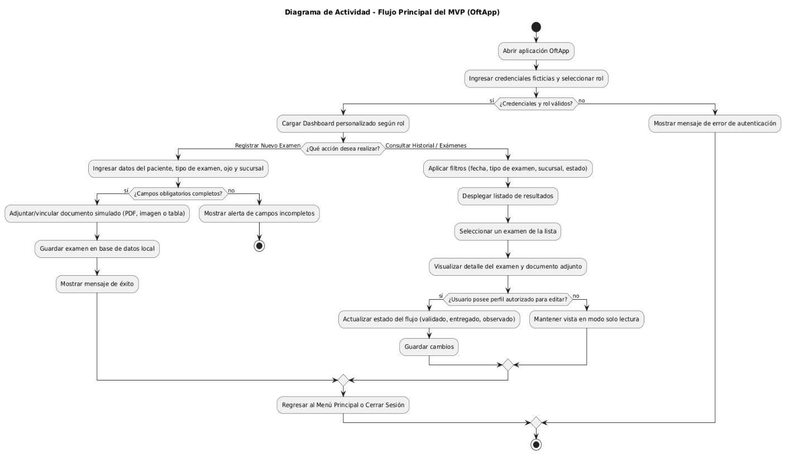

# OftApp — Plataforma Móvil para Gestión de Exámenes Oftalmológicos

<p align="center">
  
</p>

## Nombre y Propósito

**OftApp** es una aplicación móvil desarrollada en **Kotlin** con **Jetpack Compose** y arquitectura **MVVM**, diseñada para centralizar, organizar y garantizar la trazabilidad de exámenes oftalmológicos clínicos (campimetría, tomografía OCT, topografía corneal, agudeza visual, etc.) en un contexto académico con datos ficticios.

### Problema que Resuelve
Actualmente, los resultados de los exámenes oftalmológicos se generan en múltiples formatos (reportes PDF, imágenes clínicas, planillas) y se almacenan de manera dispersa en correos o carpetas locales sin una ficha digital única por paciente. 

**OftApp** resuelve esta problemática unificando los antecedentes en una base de datos local SQLite con Room, permitiendo al personal médico y técnico registrar atenciones, asociar documentos del dispositivo, consultar historiales, comparar estudios previos y gestionar estados de validación en tiempo real.

---

## Cumplimiento de Rúbrica (Clases 1 a 11)

| Requisito de Rúbrica | Implementación en OftApp |
| :--- | :--- |
| **Kotlin + Android Studio + Jetpack Compose** | Desarrollado 100% en Kotlin con Compose BOM y Gradle Kotlin DSL configurado. |
| **Arquitectura MVVM** | Separación en capas: Entidades (`data/local/ExamenEntity.kt`), Acceso a datos (`ExamenDao.kt`, `ExamRepository.kt`), Lógica de presentación (`ViewModels`) e Interfaz declarativa (`ui/screens/`). |
| **Material 3 y Navegación Efectiva** | Uso de componentes Material 3 (`Scaffold`, `NavigationBar`, `Card`, `AlertDialog`, etc.), `NavHost` centralizado en `navigation/navi.kt` y control de insets de sistema (`statusBarsPadding`). |
| **ViewModel y StateFlow** | Estado reactivo modelado mediante `StateFlow` y `Flow` en `ExamRegisterViewModel`, `ExamListViewModel` y `PatientHistoryViewModel`. |
| **Formulario Funcional y Validación** | Formulario en `ExamRegisterScreen` con validaciones de campos obligatorios (RUT, tipo de examen, sucursal/box, fecha/hora) y alertas visibles mediante `Snackbar` y `AlertDialog`. |
| **Listas con Búsqueda, Filtro y Detalle** | `ExamListScreen` con búsqueda en vivo (nombre, RUT, #examen), chips de filtrado por estado (*Todos, Validado, Pendiente, Observado*) y navegación directa al detalle clínico (`ExamDetailScreen`). |
| **Persistencia Local con Room (SQLite)** | Base de datos `OftAppDatabase` y tabla `examenes` mediante Room. Los exámenes registrados en el formulario se guardan localmente y sobreviven al cierre o reinicio de la aplicación. |
| **Integraciones con Recursos del Dispositivo** | **1. Selector de Documentos/Archivos:** `ActivityResultContracts.GetContent()` para adjuntar reportes PDF e imágenes leyendo nombre y tamaño real del almacenamiento.<br>**2. Fecha y Hora del Sistema:** `DatePickerDialog` y `TimePickerDialog` nativos para registrar el momento exacto del procedimiento. |

---

## Identidad Visual y Diseño

### Logotipo
El isotipo integra la silueta de un ojo estilizado con una cruz médica en su comisura exterior, simbolizando la especialización clínica y la tecnología médica.

### Paleta de Colores

| Rol de Color | Código HEX | Descripción / Aplicación |
| :--- | :--- | :--- |
| **Color Principal** | `#0F80AA` | Azul oceánico para botones primarios, encabezados e íconos principales |
| **Color Secundario** | `#20BAC5` | Cian brillante para estados activos, acentos y la palabra "App" |
| **Fondo** | `#F8FAFC` | Blanco clínico con tinte frío para favorecer la lectura |
| **Texto Principal** | `#1D4E89` / `#334155` | Azul marino y gris oscuro para máxima legibilidad |
| **Adicionales** | `#3FC1C0` / `#04A6C2` | Verde agua y azul medio para estados, alertas y bordes |

---

## Flujo de Usuario

El siguiente diagrama ilustra el flujo de actividades según los roles de la aplicación (Tecnólogo, Administrativo, Médico y Paciente):

<p align="center">
  
</p>

---

## Pantallas Principales

Las maquetas y evidencias de interfaz se encuentran organizadas en `docs/diseno/`:

* **`docs/diseno/01_login.png`**: Autenticación con selector de rol clínico simulado (**RF01**).
* **`docs/diseno/02_menuprincipal.png`**: Menú centralizado con accesos a los módulos de la aplicación.
* **`docs/diseno/03_dashboard.png`**: Panel de control con métricas clínicas, accesos rápidos y pacientes en espera.
* **`docs/diseno/04_lista_examenes.png`**: Catálogo reactivo conectado a Room con buscador y filtros por estado (**RF02, RF07**).
* **`docs/diseno/05_registro_examen.png`**: Formulario de ingreso de exámenes con validación, selector de archivos y fecha/hora (**RF02, RF04, RF05**).
* **`docs/diseno/06_detalle_examen.png`**: Detalle del examen, gráfico retiniano y opciones de actualización (**RF03, RF08, RF09**).
* **`docs/diseno/07_historial_paciente.png`**: Línea de tiempo cronológica de atenciones anteriores por paciente (**RF06**).

---

## Instrucciones de Ejecución

Sigue estos pasos para compilar y ejecutar **OftApp** en un emulador o dispositivo físico Android:

### 1. Requisitos Previos
* **Android Studio:** Ladybug (2024.2.1) o superior.
* **Java Development Kit (JDK):** JDK 17 o JDK 21 configurado en Gradle.
* **Android SDK:** Mínimo API 24 (Android 7.0), Target API 35/37.
* **Dispositivo de prueba:** Emulador Android (recomendado Pixel 8 / 9 con API 34+) o dispositivo físico con depuración USB habilitada.

### 2. Clonación del Repositorio
```bash
git clone https://github.com/majelss/OftApp.git
cd OftApp
```

### 3. Apertura del Proyecto en Android Studio
1. Abre Android Studio.
2. Selecciona **File > Open...** y elige la carpeta clonada `OftApp`.
3. Espera a que Gradle descargue las dependencias y sincronice el proyecto (*Gradle Sync*).

### 4. Compilación y Ejecución
* **Desde Android Studio:** Selecciona el dispositivo o emulador en la barra superior y presiona el botón **Run ▶** (o `Shift + F10`).
* **Desde Terminal (Windows PowerShell):**
  ```powershell
  .\gradlew.bat assembleDebug
  ```
  El archivo APK resultante se generará en:  
  `app/build/outputs/apk/debug/app-debug.apk`

---

## Planificación del Proyecto (Trello)

La organización de requerimientos, asignación de responsabilidades y seguimiento de pendientes se gestiona en el tablero de trabajo del equipo:

* 📋 **Tablero Trello del Proyecto:** [Planificación OftApp - Duoc UC](https://trello.com/b/oftapp-dsy1105) *(o herramienta equivalente del equipo)*

---

## Tecnologías y Librerías

* **Lenguaje:** Kotlin 2.2.10
* **UI Toolkit:** Jetpack Compose (BOM 2026.02.01) + Material Design 3
* **Arquitectura:** MVVM (Model-View-ViewModel) + Repositorio Desacoplado
* **Persistencia Local:** Room Database 2.7.2 (SQLite) + KSP (Kotlin Symbol Processing)
* **Concurrencia:** Kotlin Coroutines + StateFlow / Flow Reactivo
* **Navegación:** Jetpack Navigation Compose 2.10.1
* **Integración Dispositivo:** `ActivityResultContracts.GetContent` + `DatePickerDialog` / `TimePickerDialog`

---

## Integrantes del Equipo

* **Nikki Alvarado** — *nikalvarado-debug*
* **Alvaro Oyarzún** — *Alvarooyar*, *majelss*
* **Benjamin Almonacid** — *benjamin-almonacid*
* **Kevin Mansilla** — *Sneiker02*

> **Asignatura:** DSY1105 Desarrollo de Aplicaciones Móviles  
> **Institución:** Duoc UC Sede Puerto Montt  
> **Profesor:** Marcelo Eduardo Crisóstomo Carrasco  
> **Cliente / Contexto del Caso:** MG Ingeniería Informática SPA  
> **Evaluación:** Hito 1 (Contenidos Clases 1 a 11)  
